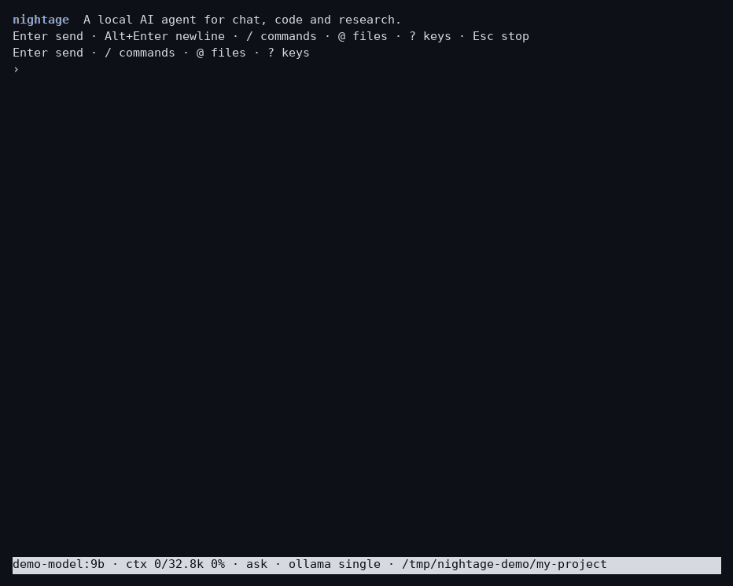
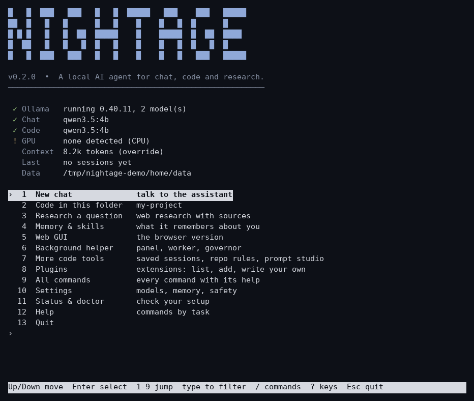
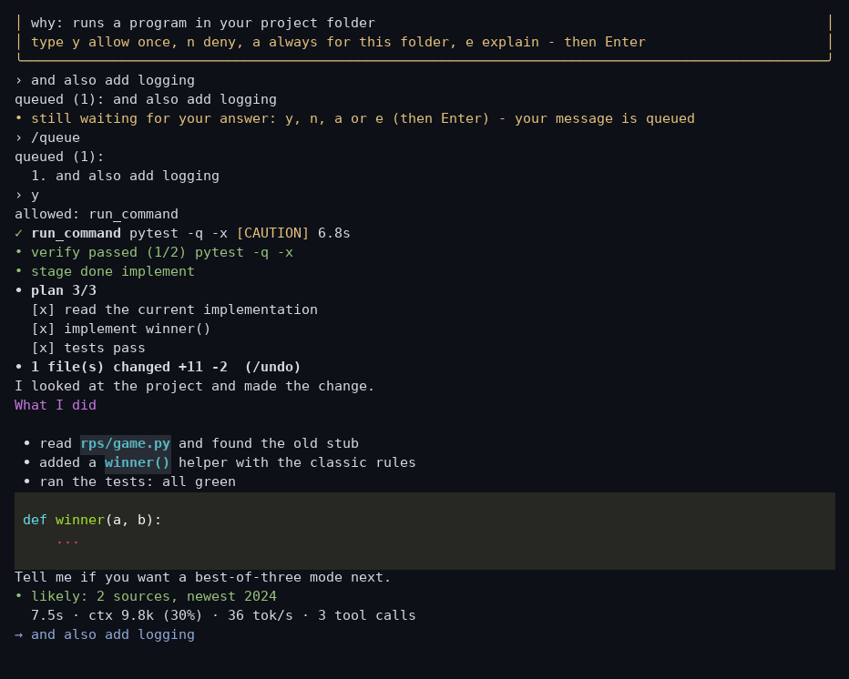
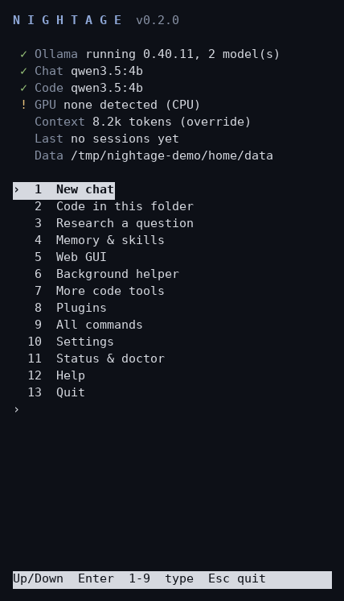

<div align="center">

# Nightage

**A local AI agent that lives in your terminal.**

It chats, remembers, searches the web, and writes code — all against your own
[Ollama](https://ollama.com). No account, no API key, nothing phoning home.

[](https://github.com/ilvy23/local-ai-agent/actions/workflows/ci.yml)


</div>

---

<div align="center">



<sub>A scripted demo run: the input stays active while the agent works, follow-ups are queued, every tool call and diff is visible, risky commands wait for your typed answer.</sub>

| Start screen | Everything visible | On a phone-sized terminal |
|:--:|:--:|:--:|
|  |  |  |

</div>

## The terminal UI in ten lines

`nightage` opens a home screen; `nightage chat`, `nightage code`, `nightage research`, `nightage doctor` and
`nightage demo` (a scripted fake AI, no Ollama needed) go straight to a mode.

- Keep typing while it generates: your messages are queued and sent in order.
- `Esc` stops the current answer; the queue is kept and can be edited or reordered.
- `/compact` folds old context into a short work log on demand.
- `/context` shows exactly what the model sees right now and how full the window is.
- `/tasks` lists background work (deep research, code runs) with its progress.
- `/transcript` shows the full detail of the last turn; `Ctrl-O` toggles verbose details (thinking, tool output, diffs).
- Tool, diff, plan and source cards are compact by default and expand on demand.
- Approval questions for risky commands appear in the input area, not as a modal.
- `--plain` (also `NO_COLOR` / `TERM=dumb`) drops colours and unicode.
- `--classic` (chat) and `--old-ui` (code) bring back the previous line-by-line interface.

The old command names `agent` and `lantern` still work as aliases (`lantern` prints a one-line rename note).
The Python package, `~/.config/agent` and the data directory keep their names on purpose.

## Why this exists

I wanted an assistant I could talk to without shipping my life to someone
else's servers. Everything here stays in one SQLite file on my disk, and the
only time anything touches the network is a web search I explicitly ask for.

It's also just a small, readable codebase. If you want to change how it thinks,
the whole thing fits in your head.

## What it does

**Remembers you.** Chats are saved and resumable. It quietly pulls durable facts
out of conversations and recalls them later by meaning, not keyword. (It used to
remember all sorts of junk. That took a while to fix.)

**Writes and fixes code.** Give it a goal — `nightage code "build a CLI word-counter
with tests"` — and it writes the files, runs them in a throwaway git worktree, and
loops until the tests pass. You watch it type in real time. Point it at a failing
test instead (`-f`) and it debugs the code. It can't fake success: every change
runs a real ladder (syntax → lint → tests), it isn't allowed to edit the tests to
cheat, and a reviewer pass rejects gamed diffs. Honest limit — a 7B is genuinely
good at focused builds and fixes; a whole complex app in one shot is past its edge,
so swap in a bigger model (`nightage code-model`) when you want more.

**Searches the web when you ask.** Put `/web` at the end of a message and it goes
and looks. You watch it visit each site in real time, and it answers with the
sources. No API key — it scrapes DuckDuckGo.

**Sharpens & anonymises your prompts.** A local prompt studio (`nightage prompt`):
**improve** a rough prompt, turn it into a full structured **plan** prompt, or
**anonymise** it so it gives nothing away about you. Work one-shot, or in a saved,
resumable chat (people rarely one-shot a prompt). The anonymiser has four
strengths — the same idea, dialled up:

| mode | a revealing prompt… | becomes |
|---|---|---|
| **light** | *"I'm Sarah Chen, a nurse at Boston General — a spreadsheet to track my patients' meds on my night shifts"* | "A spreadsheet to track patients' medication schedules for night-shift duties." |
| **heavy** | *"remind my mom Rosa in Lisbon to take her pills; I live in Berlin and worry"* | "A reminder app for a small team to help users manage medication schedules; test it locally first." |
| **poison** | *"watch my competitor TechFlow's pricing, email john@mystartup.io so my startup can undercut them"* | "A script to monitor price changes in our industry and email general-team@ourcompany.com — real-time pricing to stay competitive." |
| **max** | *"I'm Daniel, an accountant in Chicago — track what my wife Emma and I spend, I'm secretly saving for a surprise trip to Japan"* | *5 passes — distil the core, then rebuild it in a new domain →* a complete **"Expense Manager for Small Businesses"** spec. |

*light* keeps the domain and de-names it; *heavy* genericises it; *poison* adds a
plausible cover story; *max* distils to the essential capability and rebuilds it,
unrecognisable, in a different domain — while keeping the real requirements.

**Uses your computer.** It can run shell commands and read or write files. Safe
stuff runs, anything risky asks first, and genuinely dangerous things are refused
outright. Every single thing it runs is written to an audit log you can read.

**Gets out of the way when you game.** Background work checks the GPU and pauses
if you're playing something.

Run `nightage` for the home screen if you don't want to memorise commands, and
`nightage panel` for a live status panel of the machine and models.

## Install

One line, then answer the questions (each has a safe default; nothing needs admin/root, nothing is changed before you say yes).
Full guide with pictures-in-text: [docs/INSTALL.md](docs/INSTALL.md).

**Windows** (open "Windows PowerShell" from the Start menu; UNVERIFIED on real hardware, please report problems):

```powershell
irm https://raw.githubusercontent.com/ilvy23/local-ai-agent/main/install.ps1 | iex
```

**macOS, Linux, Termux:**

```sh
curl -LsSf https://raw.githubusercontent.com/ilvy23/local-ai-agent/main/install.sh | sh
```

Then type **`nightage`**. (`nightage demo` shows what it looks like without any AI model.)

Prefer to read it first? Download it, look at it, then run it: `curl -LsSf <url> -o install.sh`, `less install.sh`, `sh install.sh`
(Windows: `irm <url> -OutFile install.ps1`, `notepad install.ps1`, `powershell -ExecutionPolicy Bypass -File install.ps1`).
Options: `--dry-run` (show everything, change nothing), `--yes`, `--no-ollama`, `--no-model`, `--source`, `--uninstall`
(PowerShell: `-DryRun -Yes -NoOllama -NoModel -Source -Uninstall`).

The installer checks your system, installs [uv](https://docs.astral.sh/uv/) (which brings its own Python, so you never install Python by
hand), installs Nightage in a private environment, helps you install [Ollama](https://ollama.com), picks ONE model that fits your
RAM/GPU, and finishes with `nightage doctor`. Re-running it repairs or upgrades. Remove everything with `--uninstall`.

<details>
<summary>Already have uv and Ollama?</summary>

```bash
uv sync
ollama pull qwen2.5:7b
ollama pull bge-m3
ollama pull qwen2.5-coder:7b   # for `nightage code`
```
</details>

<details>
<summary>Plain pip instead of uv</summary>

```bash
python3 -m venv .venv && . .venv/bin/activate
pip install .
nightage doctor        # checks Python, packages, Ollama, models, GPU, config
```
</details>

**No model yet?** `nightage demo` plays a scripted fake agent so you can look around the terminal UI without
Ollama, and `nightage doctor` tells you exactly what is missing on your machine.

## Using it

```bash
uv run nightage         # the home screen
uv run nightage chat    # if you know what you want
uv run nightage code    # the coding agent in the current folder
```

(Installed with pip into an active virtualenv? Drop the `uv run`.)

In a chat, tack `/web` onto anything that needs current information:

```
you> what changed in the latest python release /web
```

It'll also decide to search on its own sometimes, though smaller models are
hit-and-miss about that, which is exactly why `/web` exists.

<details>
<summary>Every command</summary>

```
nightage chat              # new chat
nightage resume [id]       # pick up the last one, or a specific one
nightage sessions          # what you've talked about
nightage                   # the home screen
nightage code "GOAL"       # write a small program + tests, from scratch
nightage code "FIX" -f F   # debug an existing file against its tests
nightage code-model        # show / swap the coding model
nightage code-eval         # benchmark the coding loops on held-out tests
nightage memory list       # what it thinks it knows about you
nightage memory search Q   # semantic, falls back to substring
nightage memory add TEXT   # tell it something directly
nightage memory forget ID  # take it back
nightage memory prune      # bin the junk facts it scraped from tool output
nightage memory check      # test that saving and recalling a fact works here
nightage memory process    # finish saving facts that a closed chat left queued
nightage embed list        # memory (embedding) models: size, languages, what fits
nightage embed use TAG     # switch the memory model and rebuild the index
nightage audit             # everything it has run
nightage panel             # live machine + Ollama status
nightage settings show     # current config
nightage reembed MODEL     # change embedding model, rebuild the index
```
</details>

## Working autonomously (long tasks)

The chat can work on a task for a long time without you, and keeps itself honest while doing it.

**Permissions per folder.** Say `work in this repo: /path/to/project` and it asks how much it may do there:
`/auto-<dir>` (edit files and run commands without asking), `/medium-<dir>` (edit freely, ask before commands),
`/ask-<dir>` (ask for everything), `/greenlist-<dir>` (like auto, remembered for every future session;
`/greenlist` lists, `/ungreenlist-<dir>` removes). Dangerous and blocked commands still ask or refuse, and your
home directory, top-level and system folders can't be granted. Shell commands in auto mode must run inside the
folder and may only touch paths inside it - a guard rail against model slips, not a sandbox.

**One-line prompts.** Questions look like `Run this? edit rps/game.py +3 -1 [y/n]`; the code itself is never
dumped. After every prompt a summary lists the files created or edited with `+added -removed`.

**Context that doesn't run out.** The window is 65k tokens. At 50% fill old tool output and old file contents
become one-line stubs; at 70% the middle of the run is folded into a structured work log (done / state /
decisions / open / pitfalls plus an exact tool log) while the task and the last six messages stay verbatim.
The status line shows `compacting. .. ...`, and `Coding. .. ...` / `editing. .. ... -> file` in green while it writes.

**Staying honest.**
- Big build tasks get an *acceptance list* owned by the harness (`/plan`); the model confirms items with
  proof (`mark_done`) and can't call the task finished while items are open.
- After code edits the project's own check (pytest / npm test / cargo test / go test, else a syntax check)
  must pass before "done"; a failure goes back to the model, twice at most, then it says so plainly.
- When it keeps failing with the same error it searches the web for it (query stripped of paths, names and
  tokens first; `autonomy.web_lookup: false` turns that off).
- Tool-call arguments are checked and repaired before anything runs.

**Taking things back and remembering.** `/undo` restores the files the last prompt wrote (new files go to the
trash), `/undo list` shows the history; inside a git repo a private checkpoint ref
`refs/agent/checkpoints/<time>` is made before each prompt's first edit (`git checkout <ref> -- .`).
Per-project notes (how to run the tests, conventions, gotchas) are kept across sessions and loaded when you work
in that repo (`/project`).

**Web research.** `web_search` reads pages in parallel, keeps only the passages that match the query, shows dates
and sources, caches pages and results, and stores a dated research note that later chats can recall;
`web_fetch` reads one page (optionally focused or in parts).

Switches: `AGENT_VERIFY=0`, `AGENT_PLAN=0`, `AGENT_AUTO_LOOKUP=0`, `AGENT_COMPACT_AT=<0.2-0.95>`,
`AGENT_MASK_AT=<0.1-..>`, `AGENT_DRAFT_TOKENS=<n>` and the `autonomy:` keys in `config.yaml`.

## Config

`config.yaml` shows up on first run. Change models there, or with
`nightage settings set`.

| Setting | Default | What it's for |
|---|---|---|
| `models.chat` | `qwen2.5:7b` | chatting and tool use |
| `models.background` | `qwen2.5:7b` | pulling facts out of conversations |
| `models.embed` | `bge-m3` | the memory model: multilingual (German, French, ...), 1.2 GB. `all-minilm` is English only and 46 MB: `nightage embed list` |
| `coding.executor.model` | `qwen2.5-coder:7b` | the model behind `nightage code` (swap with `nightage code-model`) |

`nightage code-model` lists what you have plus a few recommended coders, from the
~4.7 GB 7B up to `qwen3-coder:30b` (a MoE that needs plenty of RAM) for agentic multi-file work.

**The chat model has to support tool calling** (`ollama show <model>` should list
`tools` under capabilities). Ollama silently ignores tools for models that don't,
and then the model will happily *invent* a directory listing rather than admit it
can't read one. `qwen2.5:7b` and `llama3.1:8b` both work; `gemma2`
doesn't. It warns you at startup if you pick one that can't.

Otherwise any Ollama model works. **Memory.** Facts about you are saved *while you chat*
(a small background model, only when the chat model is idle), so quitting never waits for
a model; anything not yet saved is finished at the next start. The memory (embedding) model
runs on the CPU and you can pick a small one to keep RAM for the chat model: English-only
`all-minilm` (46 MB) or `nomic-embed-text` (274 MB), multilingual `embeddinggemma` (239 MB)
or `bge-m3` (1.2 GB). `nightage embed use <model>` switches and rebuilds the index at the
new size; the installers offer the same short list. How it all works, how to inspect it and
what stays local: [docs/MEMORY.md](docs/MEMORY.md).

## Big models on two GPUs (Vulkan Ollama)

A 27B model does not fit on one consumer card. A second Ollama server built on the
**Vulkan** backend can split a model across *different* GPUs (e.g. an AMD and an
NVIDIA card at once), which the ROCm/CUDA servers cannot. The agent routes by model name:

- any model matching `AGENT_VULKAN_MODELS` (default: `qwen*27b*`) is sent to the Vulkan
  server at `AGENT_VULKAN_OLLAMA_URL` (default `http://127.0.0.1:11436`);
- everything else (and the embedding model, which runs on the CPU) keeps using `OLLAMA_HOST`;
- the Vulkan server is started on demand with `AGENT_VULKAN_START_CMD` (default: an
  `ollama-vk` helper on your `PATH` or in `~/.local/bin`) and left running;
- before the big model runs, models the default server still holds in VRAM are unloaded
  (and the other way round afterwards), so the two servers never fight over the cards;
- if the Vulkan server can't be reached or started, the agent logs a warning and falls back
  to the default server instead of failing.

Set `AGENT_VULKAN_MODELS=""` to turn the routing off.

### One GPU or both? (asked at the start)

When you start a command that talks to a model (`chat`, `resume`, `code`, `prompt`, `audit`, also from
the home screen), the agent asks **once per run** whether to use one GPU or both, and shows what that means for
your models: free VRAM per option and the **estimated context size** that fits next to the model's
weights (KV-cache arithmetic from the model's own architecture, the KV type of each server, and the
VRAM that is free right now). It then asks which context to use for the chat (default: the estimate for
your chat model), which the chat uses instead of `models.chat_num_ctx` for that run. This is useful when
you summarise long documents and need a lot of context.

- Choosing *both* sends **every** generating model to the Vulkan server; *one* keeps everything on `OLLAMA_HOST`.
  Embeddings always stay on the default server (CPU).
- Skip the question: `AGENT_GPU_MODE=single|dual` (and `AGENT_CHAT_CTX=<tokens>`). Not interactive and
  no choice made: the last answer is reused, else the name pattern above decides.
- With a single GPU there is nothing to choose, so nothing is asked.
- KV types assumed: `AGENT_SINGLE_KV` (default `f16`) and `AGENT_DUAL_KV` (default `q8_0`) - set them to
  what your two servers really use. The numbers are estimates; Ollama's own placement has the last word.

## How it fits together

Everything lives in one SQLite file: sessions, messages, facts, the vector index
([sqlite-vec](https://github.com/asg017/sqlite-vec)), and the audit log.

Memory is three layers stacked on each other — the raw conversation log, the
facts distilled out of it, and semantic search across both. What the model sees
each turn is the persona, plus whatever facts and past messages are actually
relevant, plus the current conversation.

Tools go through a risk classifier before they're allowed to run.

## A few honest caveats

- Small local models are not GPT-5. An 8B is fine for chat and decent at
  summarising a web page, but it will occasionally say something confidently
  wrong. The `/web` sources are there so you can check it.
- The coding agent is only as smart as the model behind it. A 7B nails focused
  builds and "fix this failing test," but a large, fully-tested app in one go is
  beyond it — that's the model, not the harness (which keeps every failure
  visible and refuses to fake a pass). A bigger model raises the ceiling.
- Some sites block scrapers. Those show up as `unreachable` and it falls back to
  the search snippet.
- Windows support (installer and the program itself) is untested on real hardware; CI runs it on Windows but nobody has used it daily. If you run it, I'd like to hear what broke (`docs/INSTALL.md`, "Troubleshooting").

## Plugins

Add your own tools, slash commands and terminal commands without touching the
code: `nightage plugin new my-plugin` makes a working starter in one command.
The full guide (API, risk levels, hooks, testing, sharing, security) is
[docs/PLUGINS.md](docs/PLUGINS.md); three small examples are in
[examples/plugins](examples/plugins). Plugins run with your permissions (no
sandbox), so only enable ones you trust. Health checks: [docs/DOCTOR.md](docs/DOCTOR.md); updating nightage and plugins: [docs/UPDATING.md](docs/UPDATING.md).

## Ideas are very welcome

Genuinely — if you've got an idea for this, I want to hear it. Half-formed is
fine, "wouldn't it be cool if" is fine, "this annoyed me" is especially fine.

- **[Discussions](https://github.com/ilvy23/local-ai-agent/discussions)** — ideas,
  questions, what you're using it for, models you'd pair it with. No format, just
  say the thing.
- **[Issues](https://github.com/ilvy23/local-ai-agent/issues)** — something's
  broken, or a concrete feature request.

You don't need to write code to be useful here. Telling me what's confusing or
what you wanted it to do is worth a lot.

## Contributing

PRs welcome too, see [CONTRIBUTING.md](CONTRIBUTING.md). Tests run without
Ollama:

```bash
uv run pytest
```

## License

[Apache License 2.0](LICENSE), Copyright 2026 ilvy23.

You may use, change and redistribute Nightage, also commercially. If you redistribute it or a work derived from it,
the license asks you to keep the [NOTICE](NOTICE) file and the copyright notices, to mark the files you changed, and not
to present your version as the original (see sections 4 and 6 of the license). Plugins you write for Nightage are yours
and can have any license you like.
